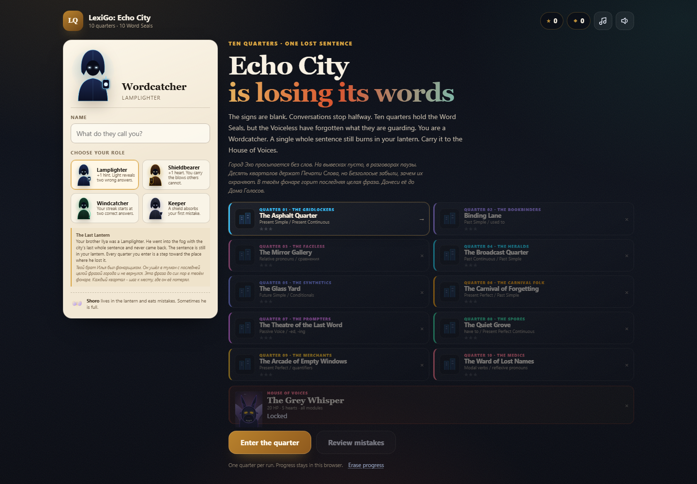
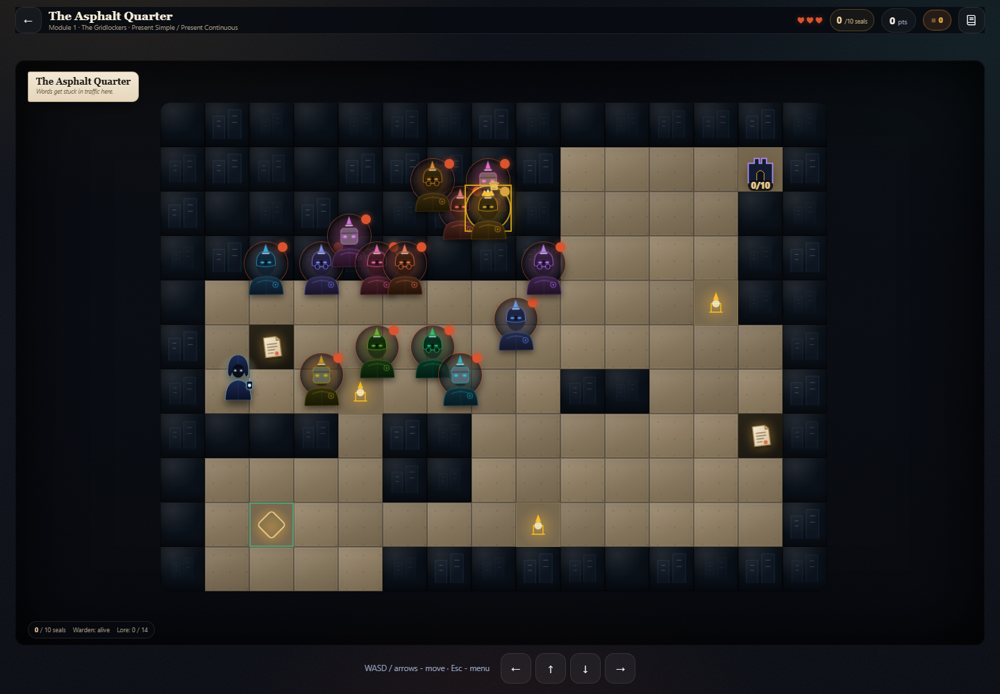
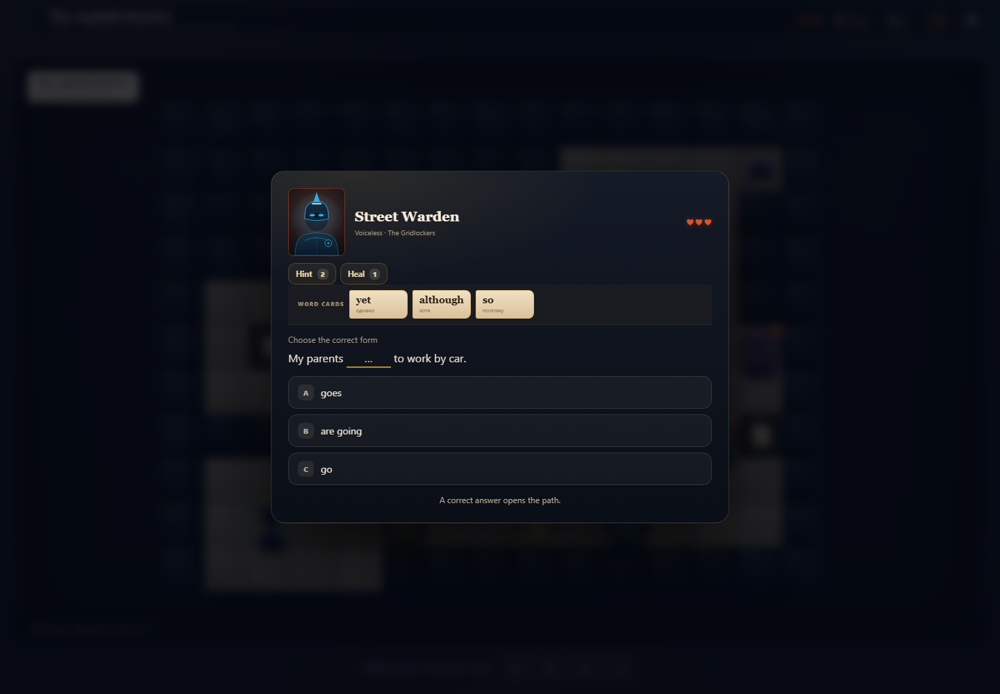
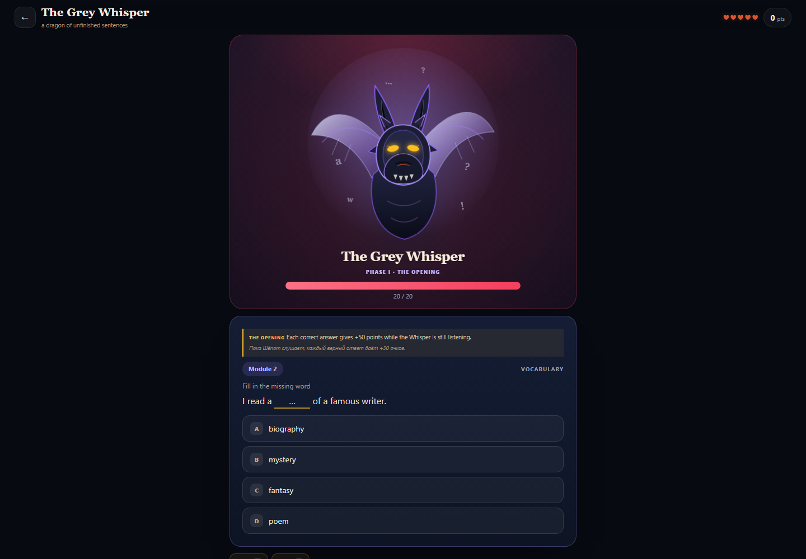
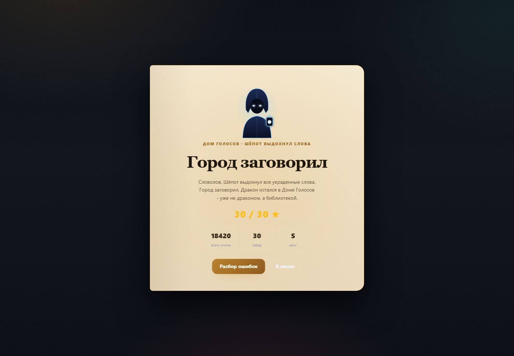
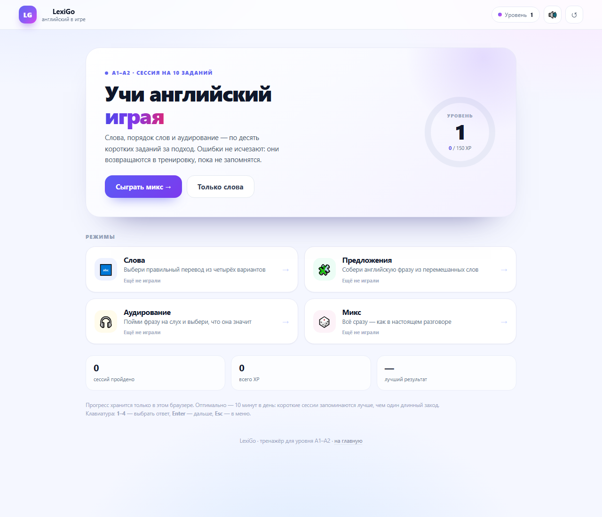
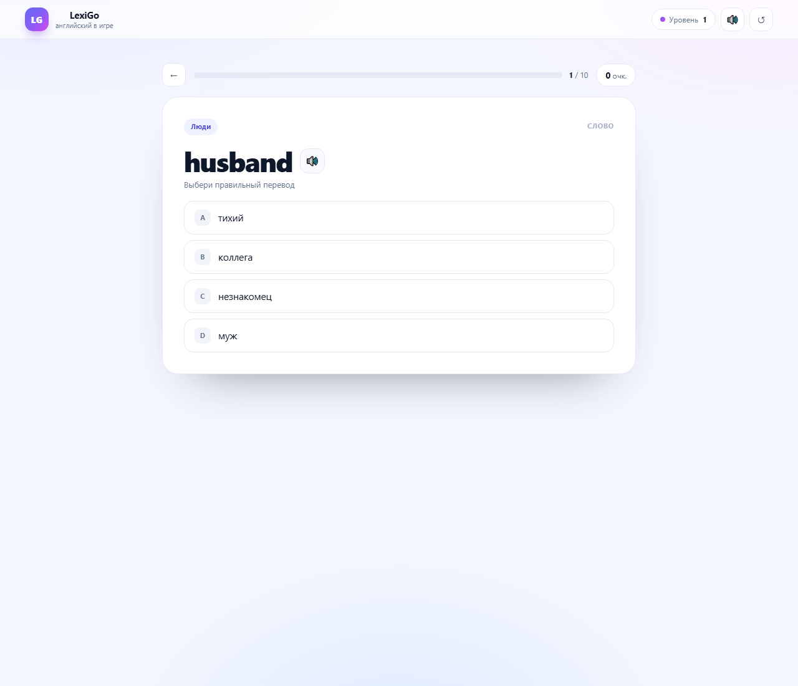
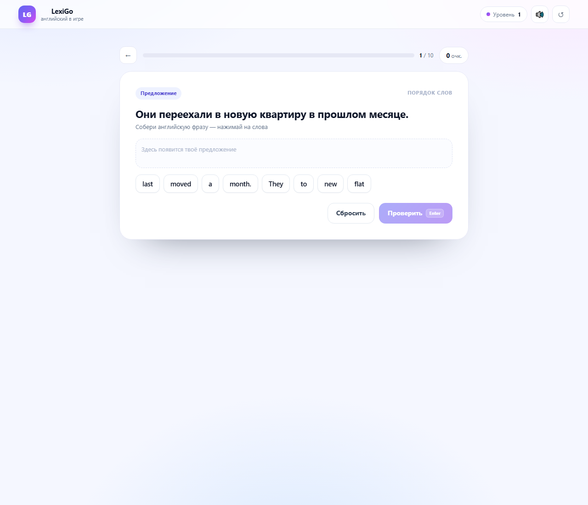
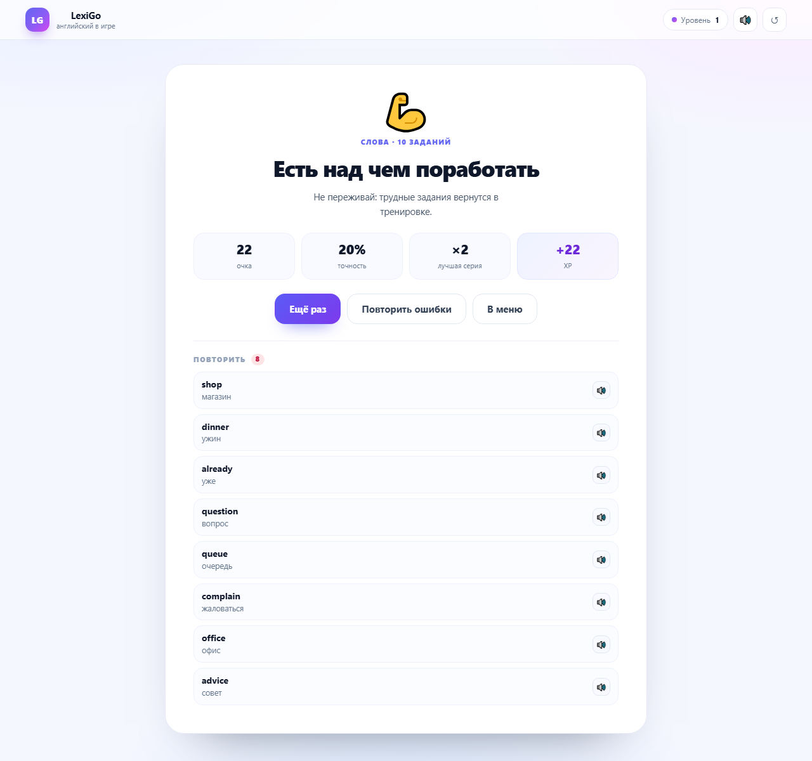
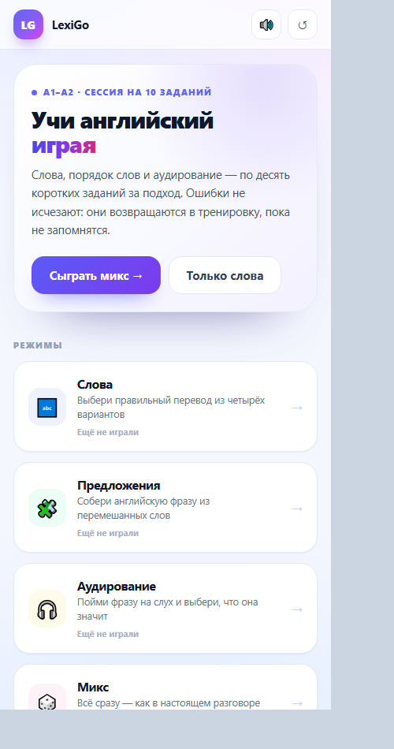

# LexiGo: Echo City

**Живая версия:** [nikitamitrasov-netizen.github.io/echo-city](https://nikitamitrasov-netizen.github.io/echo-city/)  
**Репозиторий:** [github.com/nikitamitrasov-netizen/echo-city](https://github.com/nikitamitrasov-netizen/echo-city)

Игра-приключение по **Spotlight 7** для 7 класса. Интерфейс и сюжет — на английском, ключевые сюжетные сцены и диалоги продублированы по-русски. Город Эхо теряет слова. Ты — Wordcatcher: в фонаре горит последняя целая фраза, а десять кварталов держат Печати Слова. На пути стоят Безголосые — не злодеи, а те, кто забыл, зачем охраняет свою Печать.

## Превью





















## Как играть

- Герой ходит по карте: **стрелки / WASD** или кнопки внизу.
- Перед уровнем открывается **сюжетная сцена** с целью персонажа и русским переводом.
- Стражники статичны: не преследуют и не нападают из засады. Бой начинается, только если подойти к ним вплотную.
- На карте **14 Безголосых**, но для Дома Голосов нужно **10 Печатей**. Четырёх можно обойти: маршрут и порядок боёв выбираешь сам.
- В каждом квартале есть обязательный **Quarter Warden** с 5–10 сердцами. Без его победы замок не откроется, даже если Печати собраны.
- **Святилища** (фонари) дают небольшой бонус, если дойти до них.
- **Лорные записки** лежат на карте как свитки и попадают в Journal.
- После 10 кварталов открывается **The Grey Whisper** — дракон из незаконченных фраз.

## Десять кварталов

| № | Quarter | Faction | Grammar |
|---|---|---|---|
| 1 | The Asphalt Quarter | The Gridlockers | Present Simple / Present Continuous |
| 2 | Binding Lane | The Bookbinders | Past Simple, used to |
| 3 | The Mirror Gallery | The Faceless | Relative pronouns, comparisons |
| 4 | The Broadcast Quarter | The Heralds | Past Continuous, Past Simple |
| 5 | The Glass Yard | The Synthetics | Future Simple, Conditionals |
| 6 | The Carnival of Forgetting | The Carnival Folk | Present Perfect, Past Simple |
| 7 | The Theatre of the Last Word | The Prompters | Passive Voice, -ed/-ing |
| 8 | The Quiet Grove | The Spores | have to, Present Perfect Continuous |
| 9 | The Arcade of Empty Windows | The Merchants | Present Perfect / Continuous |
| 10 | The Ward of Lost Names | The Medics | Modal verbs, reflexive pronouns |

## Что внутри

- **Уникальные карты.** Каждый квартал строится по своему ключу: другой лабиринт, другой набор ответвлений и площадь. Цвет, декор и музыка меняются вместе с кварталом.
- **Портреты врагов.** У каждого модуля три SVG-портрета Безголосых; на карте они дополнительно тонируются, чтобы стражи не сливались.
- **Ручные карты.** Все 10 кварталов собраны вручную: у каждого свой набор комнат, развилок, ориентиров, записок и арена Хранителя. Asphalt Quarter — стартовая площадь, переулки и рынок; Binding Lane — библиотечные залы; Glass Yard — лабораторные крылья; Ward — палаты и коридоры.
- **Выборы в диалогах.** У каждого класса свои две реакции. Mercy даёт классовый бонус на следующий бой (снятие варианта, щит, серия или защита серии), Defiance даёт больше очков и лишнюю карту. Выбор накапливает Mercy/Defiance и меняет силу Хранителя, Шёпота и финал.
- **Уникальные Хранители.** У каждого Quarter Warden своё правило второй фазы: щит, запрет подсказок, блокировка карт, налог на карты, лечение, регенерация и другие. Правило видно в бою.
- **Атмосфера боя.** У каждого квартала свой цветной фон арены, плавающие частицы, дышащие портреты, вспышка и тряска при ударе. Музыка боя меняется по кварталу.
- **Словесная колода.** В бою доступны карты `but`, `because`, `although`, `if`, `yet`, `so`: щит, бонус к очкам, лечение, снятие двух неверных вариантов, защита серии или дополнительная подсказка.
- **Диалоги.** Перед боем нет учебных заданий: только сцена между героем и Безголосым. У каждого из 14 стражников свой фрагмент истории квартала; все 14 фрагментов складываются в полную историю.
- **Журнал.** Фрагменты истории и лорные записки сохраняются в Journal. Записки лежат на карте как видимые свитки, а не появляются случайным окном.
- **Четыре истории.** Lamplighter ищет фразу брата, Shieldbearer несёт имена сгоревшей библиотеки, Windcatcher идёт за песней, Keeper ищет имя на последней странице. История выбранного класса видна в меню и повторяется в цели каждого квартала.
- **Классы.** Lamplighter, Shieldbearer, Windcatcher, Keeper — у каждого свой бонус, портрет и сюжет.
- **Бой.** 52 вопроса на модуль, шесть типов заданий, серии, «Вдохновение», «Туман», подсказка, лечение и щит.
- **Статичные стражи.** Безголосые стоят на постах, не преследуют героя и не нападают из засады. Бой начинается, только если подойти к ним вплотную.
- **Финальный босс.** У The Grey Whisper 20 HP и 5 сердец, но бой идёт в четыре фазы: Opening даёт бонусные очки, Silence запечатывает подсказки и лечение, Theft забирает очки, Last Page поднимает последний щит и удваивает цену ошибки.

## Запуск

Открой `index.html` двойным щелчком в браузере — сборка и сервер не нужны.

Если браузер не сохраняет прогресс на `file://`:

```powershell
python -m http.server 8100 --bind 127.0.0.1
# http://localhost:8100/
```

## Файлы

```
index.html        экраны игры
content.js        лексика, грамматика, сборка и аудирование
story.js          лор, кварталы, диалоги
lore.js           фрагменты истории и лорные записки
levels.js         10 ручных карт кварталов
game.js           карта, диалоги, бои, печати, босс
game.css          базовое оформление
game-v3.css       оформление Города Эхо
assets/
├── enemies/      портреты Безголосых, элиты, Шёпота
├── hero/         четыре класса
└── props/        декор кварталов, святилища, замок
preview/          скриншоты
```

## Технические заметки

- Чистый HTML/CSS/JS, без фреймворков и сборки.
- Карта 15×11, камера следует за героем на узких экранах.
- Прогресс: `lexigo.echo.v3` в `localStorage`.
- Озвучка: Web Speech API, `en-US`. Если звука нет, задания на аудирование не выпадают.
- Музыка и звуки: WebAudio, без внешних файлов.

## Публикация

Сайт опубликован через **GitHub Pages**:

- URL: https://nikitamitrasov-netizen.github.io/echo-city/
- Репозиторий: https://github.com/nikitamitrasov-netizen/echo-city
- Источник Pages: ветка `main`, папка `/`, файл `.nojekyll` уже добавлен.

Любой push в `main` автоматически пересобирает сайт за 30–60 секунд. Прогресс на опубликованной версии хранится отдельно от локальной.

## Ограничения

- Прогресс живёт в одном браузере.
- Озвучка зависит от голосов системы.
- Это учебная игра по мотивам УМК, а не официальное приложение издательства.
